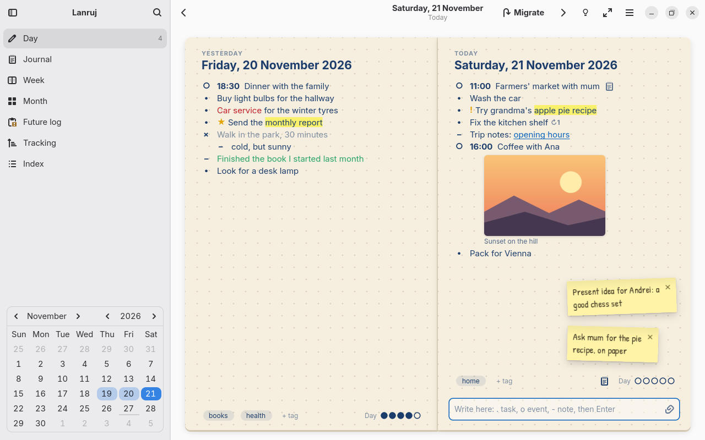

# Lanruj

A bullet journal app for Linux, built with GTK 4 and libadwaita. Lanruj helps you take notes and organise your time and routines with the bullet journal method, and keeps your journal as plain Markdown files on your computer.

The name is "jurnal" (Romanian for *journal*) written backwards.

Lanruj is built by Claude, the AI made by Anthropic, and tested by ThinkRoot.

Website: [lanruj.thinkopen.ro](https://lanruj.thinkopen.ro)



## Features

- **Day, week and month pages** and a **future log**, with yesterday and today side by side.
- **Quick writing with signs**: `.` task, `o` event, `-` note, `*` important, `!` idea.
- **Migration**: every evening, unfinished tasks are reviewed one by one (move to today, schedule, drop or keep). A task postponed several times asks whether it is still worth it.
- **Journal**: a notebook page for every day, for writing at length about what you lived and what you think:
  - bold, italic, underline, strikethrough, text colours and markers;
  - fonts and text sizes for any piece of text, and a size of its own for the whole journal;
  - headings, subheadings, quotes, bulleted, numbered (2, 2.1, 2.1.1) and check lists;
  - the time for each entry of the day;
  - web links (typed addresses become links by themselves) and links to a day, a specific task, event or note, a page or Tracking, with a sign on the linked entry that leads back to the journal.
- **Notes**: ideas jotted down quickly, like small slips of paper stuck on the notebook, on every page, until you delete them.
- **Tracking**, month by month: your own activities (ticked, counted or timed), sleep with a chart, and work (duty, standby, leave, overtime), with notes.
- **Index** with a page for each topic, **tags**, and **search** across everything: pages, journal, notes, Tracking and the Index, with exact phrases and words to leave out.
- **Colours, links, pictures and files** inside your pages.
- **Export** to PDF (a page as it looks, several days, the journal or the month's Tracking on A4 sheets), **printing**, and the whole journal as a **zip** archive, with or without a password.
- **Lock** with a password or a 4-digit PIN, locking when the screen locks, and **optional encryption** of every file (age), with a recovery key.
- **Automatic backups**, a **keyboard-first** design (every action has a key, listed with Ctrl+? and in [Keyboard shortcuts](docs/keyboard-shortcuts.md), also [in Romanian](docs/scurtaturi-de-taste.md)) with an optional **Vim key scheme**, full screen with only the pages, several paper styles, seven built-in fonts and a dark mode.
- A **first start** in three steps (language; paper, font and text size; optional encryption) and a guide (F1).
- Available in **English** and **Romanian**.

See [CHANGELOG.md](CHANGELOG.md) for everything that has been done so far.

## Installing

Lanruj comes as an AppImage and as a Flatpak, both on the [releases page](https://github.com/ThinkRoot99/Lanruj/releases). Both run on Debian 13, Ubuntu 24.04 and Linux Mint 22 or newer, Fedora, openSUSE Leap 16, Arch and other distributions at least as recent.

### AppImage

The AppImage carries everything it needs; nothing else has to be installed.

1. Download `Lanruj-<version>-x86_64.AppImage` and put it where you want to keep it, for example in `~/Applications`.
2. Make it executable: right-click it, Properties, Permissions, allow running it as a program; or in a terminal:
   ```
   chmod +x Lanruj-<version>-x86_64.AppImage
   ```
3. Double-click it, or run `./Lanruj-<version>-x86_64.AppImage`.

At every start, Lanruj adds itself to the applications menu, so after the first start you can open it from there. If you move the file, the menu entry follows it at the next start.

To update, download the new version, start it once and delete the old file.

### Flatpak

Flatpak must be installed and Flathub added. Most distributions have both; on Debian, run `sudo apt install flatpak` and follow [flathub.org/setup](https://flathub.org/setup).

There are two ways to install it; both download the GNOME 51 runtime from Flathub if it is missing.

**For you only**, without a password:

```
flatpak install --user lanruj.flatpak
```

If this is the first Flatpak app you install for yourself, Lanruj may appear in the applications menu only after you log out and back in; on Cinnamon (Linux Mint), Ctrl+Alt+Esc is enough.

**For all users** of the computer, which asks for your administrator password, because the file does not come from a signed repository such as Flathub:

```
flatpak install lanruj.flatpak
```

Lanruj appears in the applications menu right away.

Double-clicking `lanruj.flatpak` works only where GNOME Software is installed; elsewhere, for example on Linux Mint, use one of the commands above. To update, install the new `lanruj.flatpak` the same way.

### Uninstalling

Uninstalling removes the app, not your journal. Before you remove it, turn off in Preferences (if you turned them on) "Start with the computer" and "Remember the password on this computer", so nothing is left in your startup programs or in your keyring.

**AppImage:** delete the `.AppImage` file, then its menu entry and icons:

```
rm ~/.local/share/applications/io.github.ThinkRoot99.Lanruj.desktop
rm ~/.local/share/icons/hicolor/scalable/apps/io.github.ThinkRoot99.Lanruj.svg
rm ~/.local/share/icons/hicolor/symbolic/apps/io.github.ThinkRoot99.Lanruj-symbolic.svg
```

The settings stay in `~/.config/lanruj`, `~/.local/state/lanruj` and `~/.cache/lanruj`; delete these folders too if you do not want to keep them.

**Flatpak:**

```
flatpak uninstall --delete-data io.github.ThinkRoot99.Lanruj
flatpak uninstall --unused
```

If you installed it for you only, add `--user` to both commands. `--delete-data` also removes the Flatpak version's settings; the second command removes the GNOME runtime if no other app needs it.

**The journal itself** stays in `~/.lanruj` and the backups in `~/Documents/Lanruj - copii` (or the folder you chose in Preferences). Delete them only if you are sure you no longer need what you wrote.

## Your journal

The journal lives in `~/.lanruj`, as plain Markdown files:

- one file per day, for example `2026/11/2026-11-21.md`, plus files for the months, weeks, the future log (`viitor.md`) and the index (`index.md`, `pagini/`);
- the journal, one file per day: `jurnal/2026/2026-11-21.md`;
- Tracking, one file per month: `monitorizare/2026-11.md`;
- the notes: `bilete.md`.

Pictures sit next to the day they belong to. When encryption is off, you can read and edit the files with any text editor, and sync them between computers with Syncthing.

## Building from source

You need Rust (1.88 or newer), GTK 4.18 or newer and libadwaita 1.8 or newer, with their development files.

```
cargo build --release
./target/release/lanruj
```

To try the app without touching your real journal, point it to another folder:

```
LANRUJ_DIR=/path/to/a/test/folder cargo run
```

## Project layout

- `crates/lanruj-core`: the journal itself (Markdown format, migration, index, search, encryption), with tests.
- `crates/lanruj-gtk`: the GTK application.
- `data/icons`: the app icon.
- `data/fonts`: the bundled fonts and their licences.
- `data/screenshots`: the screenshot shown above.
- `flatpak`: the Flatpak recipe; `appimage`: the AppImage build (`sh appimage/construieste.sh`, in an Ubuntu 26.04 container with podman) and its test on bare images of several distributions (`appimage/proba.sh`).

## Fonts

Lanruj comes with seven fonts for the notebook pages, chosen in Preferences: Inter, Noto Sans, Caveat and Patrick Hand (handwriting), Lora (book), Courier Prime (typewriter) and Nunito (rounded). They are built into the app, so they work without being installed on the system. All of them are released under the SIL Open Font License 1.1; their licences are in `data/fonts`.

## Licence

Lanruj is free software, released under the GNU General Public License, version 3 or later (GPL-3.0-or-later). See [LICENSE](LICENSE).

The Bullet Journal method was created by Ryder Carroll. Lanruj is an independent app and is not affiliated with it or its creator.
